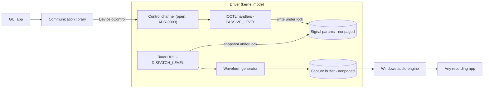
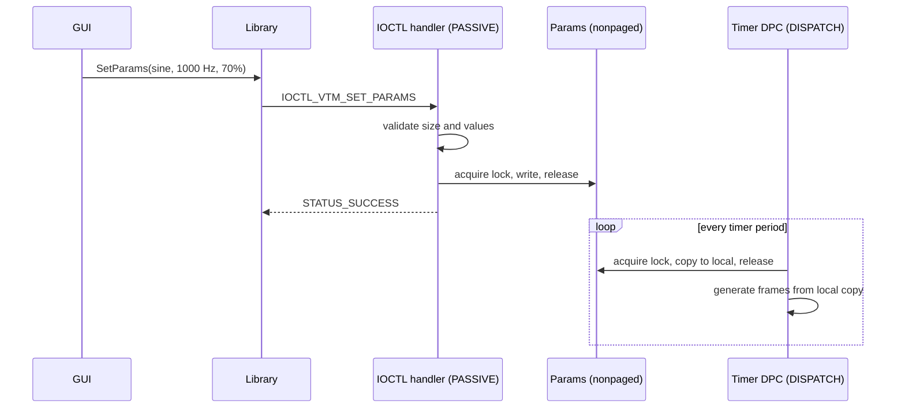

# Architecture

> Living document. Parts marked *(open)* depend on decisions in [adr/](adr/README.md).

## Components

| Component | Runs in | Responsibility |
|---|---|---|
| **Driver** | Kernel mode | Exposes the capture endpoint, generates audio in a timer DPC, handles control IOCTLs. |
| **Shared header** (`common/`) | Both | IOCTL codes, parameter struct, limits, defaults. |
| **Communication library** (`lib/`) | User mode | Finds and opens the driver, wraps IOCTLs in a simple API, reports errors. |
| **GUI** (`gui/`) | User mode | Controls for the signal; uses only the library. |

## Data flow

## Changing a parameter while recording

The stream never restarts: the DPC simply picks up the new values on its next run (spec R7).

## IRQL and memory rules

| Code | IRQL | Memory it may touch |
|---|---|---|
| DriverEntry, AddDevice, IOCTL handlers | PASSIVE_LEVEL | Paged or nonpaged |
| Timer DPC, waveform generator | DISPATCH_LEVEL | **Nonpaged only**, no blocking calls, no pageable functions |
| Code holding a spin lock | DISPATCH_LEVEL | Same as DPC; keep the locked section tiny |

## Signal generation notes

- Format: 48,000 frames/s × 2 channels × 2 bytes = 192,000 bytes/s.
- Keep a running **phase accumulator** so changing frequency doesn't cause clicks.
- Sine without floating point in the DPC is safest (lookup table or fixed-point). If floating point is
  used at DISPATCH_LEVEL, it must be protected with `KeSaveExtendedProcessorState` / `KeRestoreExtendedProcessorState`.
- Noise: a small integer PRNG (e.g. xorshift) with its state in nonpaged memory.
- Amplitude: scale samples by `AmplitudePercent / 100` in integer math, clamp to the 16-bit range.

## Open points
- How the library reaches a PortCls/ACX driver → [ADR-0003](adr/0003-control-channel.md)
- Driver model → [ADR-0001](adr/0001-driver-model.md)
